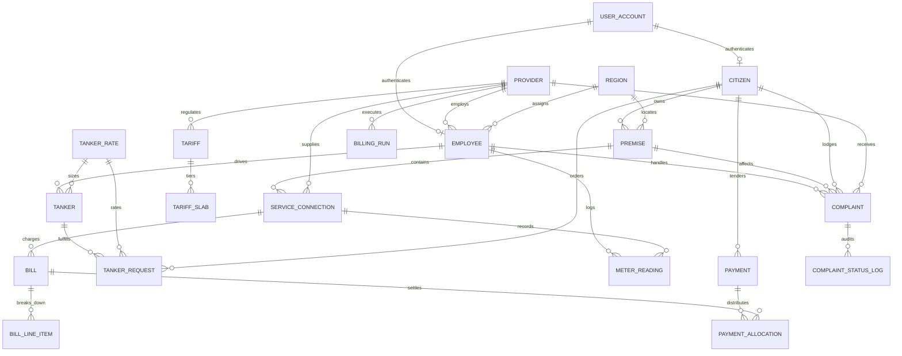
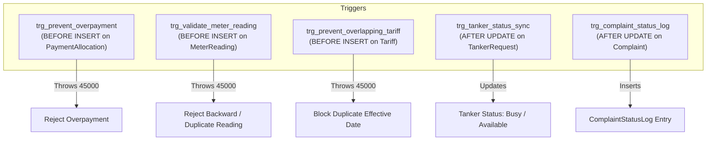
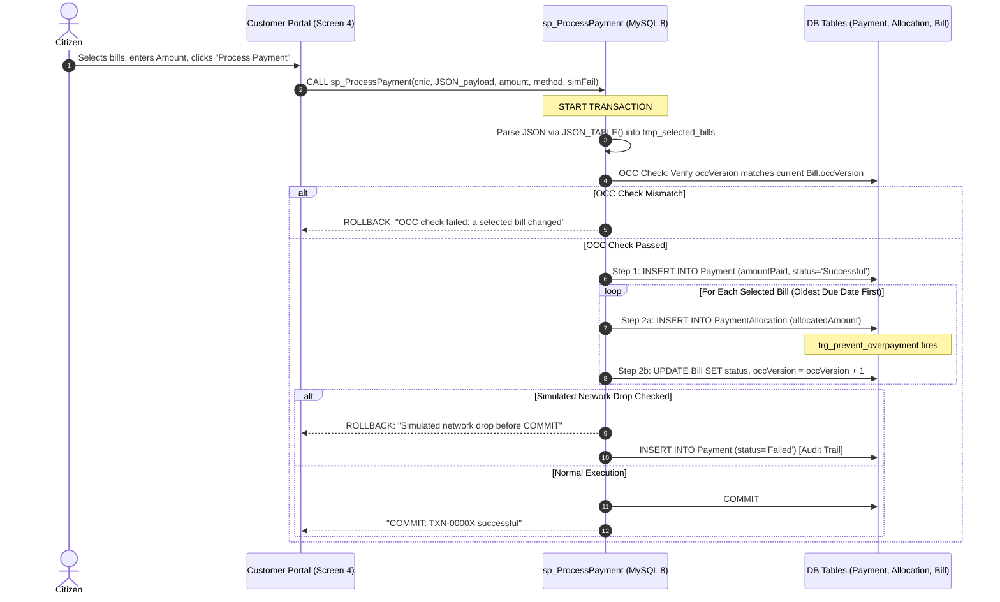
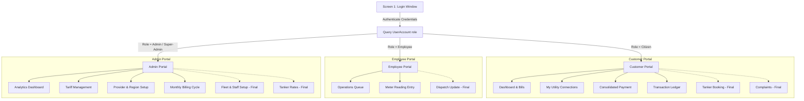
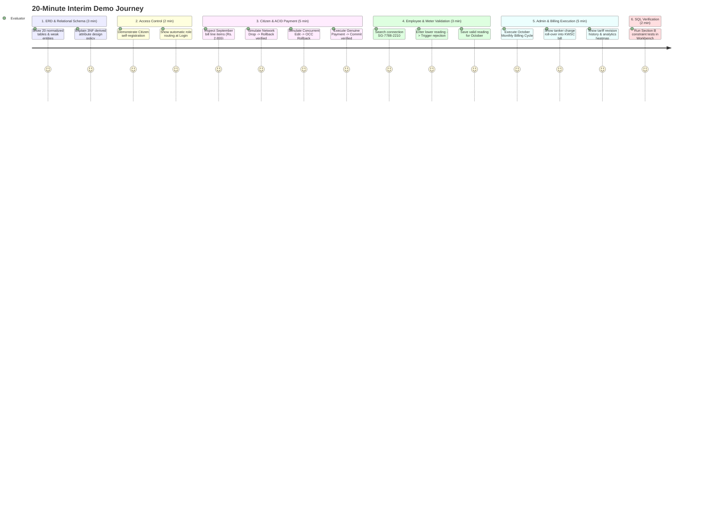

# PUUMS – Project Context, DBMS Architecture & Memory Guide
**Pakistan Unified Utility Management System**  
*Course:* CS/CE 355/373 – Database Systems, Habib University  
*Project Group:* Group 2 (Section L6, Batch 2028)  
*Authors:* Maria Khan (ID: `mk10000`), Basil Saeed Bari (ID: `bb09892`)  
*Evaluation Milestones:* Proposal (10%) | Interim ERD (20%) | Interim Demo (30%) | Final Presentation & Submission (40%)  
*Current Milestone Status:* Interim Demo (Exceeds 50% implementation requirement: **12 of 18 screens functional = 67% progress**, 100% of planned DB artifacts built).  
*Systems Engineering Traceability:* For full-verbosity systems engineering breakdowns and gap specifications, see [implementation_status.md](implementation_status.md).  
*UI/UX Design Specification:* For complete design decisions, wireframes, color palettes, and screen recreation recipes, see [design.md](design.md).

---

## 1. Executive Summary & Problem Context

### 1.1 The Real-World Problem
In Pakistan's municipal infrastructure, public utility distribution is severely fragmented across siloed entities:
- **Electricity:** K-Electric (KE)
- **Natural Gas:** Sui Southern Gas Company (SSGC)
- **Water & Sanitation:** Karachi Water & Sewerage Corporation (KWSC)

Currently, each entity operates disconnected legacy database systems. Consequently:
1. **Duplicate Citizen & Premise Data:** The exact same physical household and citizen profile are duplicated, inconsistent, and desynchronized across three separate databases.
2. **Citizen Inconvenience:** Households cannot view, track, or settle their utility obligations in a single unified interface.
3. **Billing Inefficiencies & Revenue Leakage:** Recoveries, water tanker arrears, and consumption histories lack centralized auditing and cross-departmental correlation.

### 1.2 PUUMS Mission & Solution Scope
The **Pakistan Unified Utility Management System (PUUMS)** provides a centralized, highly normalized Relational Database Management System (RDBMS) paired with an intuitive desktop interface.
- **Single Source of Truth:** A citizen registers once with their National Identity Card (CNIC), links one or more premises (residential or commercial), and maps each premise to active utility service connections (`ServiceConnection`).
- **Separation of Water Services:**
  - *Metered Piped Water:* Measured through regular monthly meter readings and billed via tiered slab tariffs.
  - *On-Demand Water Tankers:* Booked ad-hoc per delivery capacity (1,000L, 2,000L, 5,000L) from an admin-configured flat rate schedule (`TankerRate`); unpaid deliveries are rolled into the citizen's next monthly KWSC piped water bill as itemized line items.
- **Pilot Scope:** Scoped as a pilot proof-of-concept covering **Karachi** across 7 administrative districts (Karachi East, West, South, Central, Korangi, Malir, Keamari). The schema is provider- and region-agnostic, enabling seamless expansion to other utilities (e.g., LESCO, SNGPL, WAPDA) purely as data rows without DDL schema restructuring.

---

## 2. Technology Stack & Technical Design Choices

| Layer | Technology | Technical Justification |
|---|---|---|
| **Database Engine** | **MySQL 8.0+** (InnoDB Engine, utf8mb4) | Evaluated over MariaDB/XAMPP and MS SQL Server. Required for native support of `JSON_TABLE()` (used in multi-bill payment transactions), Common Table Expressions (CTEs), window functions (`ROW_NUMBER()`), and strict standard compliance (`DELIMITER`, `AUTO_INCREMENT`, `SIGNAL SQLSTATE '45000'`). |
| **Backend & Logic** | **Python 3.10+ / Stored Procedures / Triggers** | Dual-tier logic: Data integrity, cascading calculations, OCC concurrency, and ACID transactions reside strictly inside MySQL stored procedures and triggers. Python serves as the application controller and GUI presenter. |
| **Desktop GUI** | **PyQt5 (Qt 5.15+)** | Responsive desktop framework. All 18 screen layouts are constructed programmatically using clean Qt widgets mirroring the submitted Qt Designer mockups. |
| **Database Connector** | **PyMySQL 1.1+ (with cryptography)** | Pure-Python MySQL driver supporting `CLIENT.MULTI_STATEMENTS`, allowing execution of complex SQL scripts, transaction blocks, and `mogrify` statement capture. |
| **SQL Transparency** | **Live SQL Log Dock (`SqlLogDock`)** | Built directly into every portal window. Intercepts and formats every SQL statement run by the user interface with real parameters, enabling instant demonstration during course viva/interim demo. |
| **Packaging & Distribution** | **PyInstaller Isolated Build Step** | Standalone packaging tool located in `packaging/` that compiles the Python/PyQt5 application into `PUUMS.exe` without altering development files or requiring Python on client evaluation machines. |

---

## 3. Comprehensive Database Schema & Entities

The relational database `puums` is built strictly in Third Normal Form (3NF) and contains **20 tables**, with clear foreign keys, composite primary keys, and integrity constraints.



### 3.1 Entity Catalog & Structural Definitions

#### 1. `Region`
- **Purpose:** Stores administrative municipal districts.
- **Columns:** `regionId` (PK, INT AUTO_INCREMENT), `regionName` (VARCHAR(60)), `city` (VARCHAR(40)), `province` (VARCHAR(40)).
- **Constraints:** `UNIQUE(regionName, city)`.

#### 2. `Provider`
- **Purpose:** Utility distribution companies operating in the jurisdiction.
- **Columns:** `providerId` (PK, INT AUTO_INCREMENT), `providerName` (VARCHAR(60) UNIQUE), `utilityType` (VARCHAR(30)), `contactPhone` (VARCHAR(15)), `department` (VARCHAR(60)).
- **Constraints:** `CHECK (utilityType IN ('Electricity','Gas','Piped Water'))`.

#### 3. `UserAccount`
- **Purpose:** Centralized authentication credentials and RBAC roles.
- **Columns:** `accountId` (PK, INT AUTO_INCREMENT), `username` (VARCHAR(50) UNIQUE), `passwordHash` (VARCHAR(255)), `role` (VARCHAR(30)), `createdAt` (DATETIME), `lastLogin` (DATETIME NULL).
- **Constraints:** `CHECK (role IN ('Citizen','Employee','Admin','Super-Admin'))`. Passwords hashed with SHA-256 via `SHA2(password, 256)`.

#### 4. `Citizen`
- **Purpose:** Citizen personal profiles linked directly to CNIC.
- **Columns:** `cnic` (PK, CHAR(15)), `firstName` (VARCHAR(50)), `lastName` (VARCHAR(50)), `phone` (VARCHAR(15)), `email` (VARCHAR(100) UNIQUE), `accountId` (INT UNIQUE, FK -> `UserAccount.accountId`).
- **Constraints:** `CHECK (cnic REGEXP '^[0-9]{5}-[0-9]{7}-[0-9]$')`.

#### 5. `Employee`
- **Purpose:** Operational staff (meter readers, dispatchers, drivers, system administrators).
- **Columns:** `employeeId` (PK, INT AUTO_INCREMENT), `name` (VARCHAR(100)), `phone` (VARCHAR(15)), `email` (VARCHAR(100) UNIQUE), `role` (VARCHAR(30)), `department` (VARCHAR(60)), `accountId` (INT NULL UNIQUE, FK -> `UserAccount.accountId`), `providerId` (INT NULL, FK -> `Provider.providerId`), `regionId` (INT NULL, FK -> `Region.regionId`).

#### 6. `Premise`
- **Purpose:** Physical properties owned or occupied by citizens.
- **Columns:** `premiseId` (PK, INT AUTO_INCREMENT), `address` (VARCHAR(150)), `houseNo` (VARCHAR(20)), `street` (VARCHAR(60)), `area` (VARCHAR(60)), `premiseType` (VARCHAR(30)), `cnic` (CHAR(15), FK -> `Citizen.cnic`), `regionId` (INT, FK -> `Region.regionId`).
- **Constraints:** `CHECK (premiseType IN ('Residential','Commercial'))`.

#### 7. `ServiceConnection`
- **Purpose:** Links a premise to a specific utility provider; represents the physical meter and account number.
- **Columns:** `connectionId` (PK, INT AUTO_INCREMENT), `consumerNo` (VARCHAR(20) UNIQUE), `meterNo` (VARCHAR(20) UNIQUE), `connectionDate` (DATE), `status` (VARCHAR(30)), `premiseId` (INT, FK -> `Premise.premiseId`), `providerId` (INT, FK -> `Provider.providerId`).
- **Constraints:** `UNIQUE(premiseId, providerId)` (prevents overlapping accounts for the same utility at the same premise), `CHECK (status IN ('Active','Inactive'))`.

#### 8. `Tariff`
- **Purpose:** Regulatory tariff schedules (e.g., NEPRA electricity tariffs, OGRA gas tariffs).
- **Columns:** `tariffId` (PK, INT AUTO_INCREMENT), `consumerCategory` (VARCHAR(30)), `fixedCharges` (DECIMAL(10,2)), `fpaRate` (DECIMAL(8,2)), `gstPercent` (DECIMAL(5,2)), `effectiveDate` (DATE), `providerId` (INT, FK -> `Provider.providerId`).
- **Constraints:** `CHECK (consumerCategory IN ('Residential','Commercial'))`, `CHECK (fixedCharges >= 0 AND fpaRate >= 0 AND gstPercent BETWEEN 0 AND 100)`.

#### 9. `TariffSlab` *(Weak Entity of `Tariff`)*
- **Purpose:** Non-linear consumption tiers within a tariff schedule.
- **Columns:** `tariffId` (INT), `slabNumber` (INT), `minUnits` (INT), `maxUnits` (INT NULL - NULL represents open-ended upper slab), `ratePerUnit` (DECIMAL(8,2)).
- **Primary Key:** Composite `(tariffId, slabNumber)`.
- **Foreign Key:** `FK (tariffId) REFERENCES Tariff(tariffId) ON DELETE CASCADE`.
- **Constraints:** `CHECK (minUnits >= 0 AND (maxUnits IS NULL OR maxUnits >= minUnits) AND ratePerUnit >= 0)`.

#### 10. `MeterReading`
- **Purpose:** Monthly physical meter inspection logs logged by meter readers.
- **Columns:** `readingId` (PK, INT AUTO_INCREMENT), `readingMonth` (DATE, standardized to 1st of month), `readingDate` (DATE), `previousReading` (DECIMAL(12,2) NULL - auto-populated by trigger), `currentReading` (DECIMAL(12,2)), `connectionId` (INT, FK -> `ServiceConnection.connectionId`), `employeeId` (INT, FK -> `Employee.employeeId`).
- **Constraints:** `UNIQUE (connectionId, readingMonth)` (strictly enforces at most one reading per service connection per billing period).

#### 11. `Bill`
- **Purpose:** Monthly master utility invoices generated per connection.
- **Columns:** `billId` (PK, INT AUTO_INCREMENT), `billingMonth` (DATE), `issueDate` (DATE), `dueDate` (DATE), `baseAmount` (DECIMAL(12,2)), `fpaAmount` (DECIMAL(12,2)), `gstAmount` (DECIMAL(12,2)), `tankerArrears` (DECIMAL(12,2)), `status` (VARCHAR(30)), `occVersion` (INT DEFAULT 0), `connectionId` (INT, FK -> `ServiceConnection.connectionId`).
- **Constraints:** `UNIQUE (connectionId, billingMonth)`, `CHECK (status IN ('Unpaid','Partially Paid','Paid'))`.

#### 12. `BillLineItem` *(Weak Entity of `Bill`)*
- **Purpose:** Transparent, itemized breakdown of all charges comprising a bill.
- **Columns:** `billId` (INT), `itemNo` (INT), `chargeDescription` (VARCHAR(100)), `units` (DECIMAL(12,2)), `unitRate` (DECIMAL(8,2)).
- **Primary Key:** Composite `(billId, itemNo)`.
- **Foreign Key:** `FK (billId) REFERENCES Bill(billId) ON DELETE CASCADE`.

#### 13. `Payment`
- **Purpose:** Monetary settlement transactions tendered by citizens.
- **Columns:** `paymentId` (PK, INT AUTO_INCREMENT), `paymentDate` (DATETIME DEFAULT CURRENT_TIMESTAMP), `amountPaid` (DECIMAL(12,2)), `paymentMethod` (VARCHAR(30)), `transactionStatus` (VARCHAR(30)), `cnic` (CHAR(15), FK -> `Citizen.cnic`).
- **Constraints:** `CHECK (amountPaid > 0)`, `CHECK (paymentMethod IN ('Card','Bank Transfer','JazzCash','EasyPaisa','Cash'))`.

#### 14. `PaymentAllocation`
- **Purpose:** Junction entity modeling the M:N relationship between payments and bills. Enables settling multiple bills across multiple utilities in a single transaction.
- **Columns:** `allocationId` (PK, INT AUTO_INCREMENT), `paymentId` (INT, FK -> `Payment.paymentId`), `billId` (INT, FK -> `Bill.billId`), `allocatedAmount` (DECIMAL(12,2)), `allocationDate` (DATETIME DEFAULT CURRENT_TIMESTAMP).
- **Constraints:** `UNIQUE (paymentId, billId)`, `CHECK (allocatedAmount > 0)`.

#### 15. `TankerRate`
- **Purpose:** Official pricing table for on-demand water tankers per capacity volume.
- **Columns:** `capacityTier` (PK, INT - 1000, 2000, 5000 Litres), `baseFlatRate` (DECIMAL(10,2)), `urgencySurcharge` (DECIMAL(10,2)), `effectiveDate` (DATE).

#### 16. `Tanker`
- **Purpose:** Water tanker fleet physical asset registry.
- **Columns:** `vehicleNo` (PK, VARCHAR(15)), `capacityLiters` (INT), `status` (VARCHAR(30)), `lastMaintenanceDate` (DATE), `capacityTier` (INT, FK -> `TankerRate.capacityTier`), `driverId` (INT NULL, FK -> `Employee.employeeId`).
- **Constraints:** `CHECK (status IN ('Available','Busy','Maintenance'))`.

#### 17. `TankerRequest`
- **Purpose:** Ad-hoc water tanker delivery bookings made by citizens.
- **Columns:** `requestId` (PK, INT AUTO_INCREMENT), `deliveryDate` (DATE), `urgency` (VARCHAR(30)), `deliveryAddress` (VARCHAR(150)), `status` (VARCHAR(30)), `cnic` (CHAR(15), FK -> `Citizen.cnic`), `vehicleNo` (VARCHAR(15) NULL, FK -> `Tanker.vehicleNo`), `capacityTier` (INT, FK -> `TankerRate.capacityTier`), `cost` (DECIMAL(10,2)).
- **Constraints:** `CHECK (status IN ('Pending','Dispatched','Delivered','Cancelled'))`, `CHECK (urgency IN ('Standard','Urgent'))`.

#### 18. `Complaint`
- **Purpose:** Customer service tickets for outages, leakage, meter defects, or billing issues.
- **Columns:** `ticketId` (PK, INT AUTO_INCREMENT), `category` (VARCHAR(30)), `filingDate` (DATETIME DEFAULT CURRENT_TIMESTAMP), `description` (TEXT), `status` (VARCHAR(30)), `resolutionNotes` (TEXT), `cnic` (CHAR(15), FK -> `Citizen.cnic`), `premiseId` (INT, FK -> `Premise.premiseId`), `employeeId` (INT NULL, FK -> `Employee.employeeId`), `providerId` (INT NULL, FK -> `Provider.providerId`).
- **Constraints:** `CHECK (category IN ('Outage','Billing Error','Meter Fault','Leakage'))`, `CHECK (status IN ('Open','In Progress','Resolved'))`.

#### 19. `ComplaintStatusLog`
- **Purpose:** Immutable audit trail table capturing every state change of a complaint.
- **Columns:** `logId` (PK, INT AUTO_INCREMENT), `ticketId` (INT, FK -> `Complaint.ticketId`), `oldStatus` (VARCHAR(30)), `newStatus` (VARCHAR(30)), `changedAt` (DATETIME DEFAULT CURRENT_TIMESTAMP).

#### 20. `BillingRun`
- **Purpose:** Execution history and statistical summary of batch billing procedures.
- **Columns:** `runId` (PK, INT AUTO_INCREMENT), `billingMonth` (DATE), `providerId` (INT NULL, FK -> `Provider.providerId` - NULL denotes all providers), `billsGenerated` (INT), `billsSkipped` (INT), `billsFailed` (INT), `runBy` (VARCHAR(50)), `runAt` (DATETIME DEFAULT CURRENT_TIMESTAMP).

---

### 3.2 Schema Additions & Evolutions vs Initial Submitted ERD

During implementation, five essential structural refinements were made to ensure mathematical rigor, auditability, and compliance with MySQL 8.0:

| Change | Rationale & DBMS Significance |
|---|---|
| **`TankerRequest.capacityTier` & `TankerRequest.cost`** | When a citizen requests a tanker, it is initially in `Pending` state with no vehicle or driver assigned (`vehicleNo IS NULL`). Hence, capacity and price snapshot must be recorded on the request itself. Storing `cost` at booking time prevents retrospective price mutations if `TankerRate` changes later. |
| **`Complaint.providerId`** | A citizen may report an issue (e.g., an outage) that is specific to a utility company (K-Electric vs KWSC). Linking `providerId` directly enables filtering the operations task queue by department. |
| **`ComplaintStatusLog` Table** | Created as the explicit target table for the audit trigger `trg_complaint_status_log`. Preserves historical lifecycle transitions without modifying `Complaint`. |
| **`BillingRun` Table** | Powers the billing history grid on Screen 18. Counters for skipped or failed bills are transient during stored procedure execution and cannot be reconstructed retroactively. |
| **Renamed Count Columns in `BillingRun`** | Initial proposal labeled columns as `generated`. In MySQL 8.0+, `GENERATED` is a reserved keyword (used in generated/virtual columns). Renamed to `billsGenerated`, `billsSkipped`, and `billsFailed`. |

---

## 4. Relational Normalization Justification (1NF to 3NF)

Normalization is central to relational database design to eliminate insertion, update, and deletion anomalies.

### 4.1 First Normal Form (1NF)
- **Criterion:** All attribute values are atomic; no repeating groups, arrays, or comma-separated strings exist.
- **PUUMS Enforcement:**
  - A citizen's premise does not store multiple utility accounts in a CSV list (e.g., `KE-0412345, SG-7788-2210`). Instead, each utility is modeled as a distinct row in `ServiceConnection`.
  - In `Bill`, charges are not stored as un-atomic aggregates or multi-column lists (`slab1_units, slab1_rate, slab2_units...`). Instead, every charge component is normalized into atomic rows in the weak entity `BillLineItem`.
  - CNIC, phone numbers, and dates are stored in distinct scalar columns.

### 4.2 Second Normal Form (2NF)
- **Criterion:** Must be in 1NF, and every non-prime attribute must be fully functionally dependent on the entire primary key (no partial dependencies on composite keys).
- **PUUMS Enforcement:**
  - Weak entities `TariffSlab` (PK: `tariffId, slabNumber`) and `BillLineItem` (PK: `billId, itemNo`) have composite keys.
  - In `TariffSlab`, `minUnits`, `maxUnits`, and `ratePerUnit` depend on both which tariff it belongs to (`tariffId`) and which step it is (`slabNumber`). If provider details were stored in `TariffSlab`, they would depend only on `tariffId` (a partial dependency). By isolating provider configuration in `Tariff`, partial dependencies are eliminated.
  - In `PaymentAllocation` (PK: `allocationId`, with candidate composite key `paymentId, billId`), `allocatedAmount` depends strictly on the specific pairing of payment and bill.

### 4.3 Third Normal Form (3NF) & The Derived Attributes Policy
- **Criterion:** Must be in 2NF, and no non-prime attribute may transitively depend on another non-prime attribute (X -> Y, Y -> Z).
- **PUUMS Enforcement:**
  - In `ServiceConnection`, only `premiseId` and `providerId` are stored. The premise's geographic region, city, and province are not repeated in `ServiceConnection`; they are retrieved through foreign key traversals (`Premise -> Region`).
  - **Elimination of Stored Derived Data:**
    - `totalAmount`, `paidAmount`, and `balanceDue` are **never stored as columns** in `Bill`. Storing a calculated balance causes write/update anomalies whenever a payment allocation is inserted or modified. Instead, `vw_BillBalance` dynamically derives these using `COALESCE(SUM(allocatedAmount), 0)`.
    - `unitsConsumed` in `MeterReading` is dynamically derived as `(currentReading - previousReading)`.
    - Total citizen debt and collection efficiency percentages are computed on-the-fly via views (`vw_OutstandingDebt`, `vw_CollectionEfficiency`).

---

## 5. Advanced Database Objects: Triggers, Stored Procedures, and Views

### 5.1 Active Database Triggers



1. **`trg_prevent_overpayment`** *(BEFORE INSERT ON `PaymentAllocation`)*
   - **Logic:** Queries total charges from `Bill` (`baseAmount + fpaAmount + gstAmount + tankerArrears`) and subtracts prior allocations from `PaymentAllocation`.
   - **Enforcement:** If `NEW.allocatedAmount > total - paid`, throws `SIGNAL SQLSTATE '45000'` with message: `"Overpayment: allocation exceeds remaining bill balance"`.

2. **`trg_validate_meter_reading` & `trg_validate_meter_reading_upd`** *(BEFORE INSERT / UPDATE ON `MeterReading`)*
   - **Logic:** Standardizes `readingMonth` to the 1st of the month. Automatically queries the immediate preceding reading if `previousReading` is omitted.
   - **Enforcement:**
     - Duplicate check: Raises error if a reading already exists for that `connectionId` and `readingMonth`.
     - Invariant check: Raises `SIGNAL SQLSTATE '45000'` (`"Current reading cannot be below previous reading"`) if `currentReading < previousReading`.

3. **`trg_prevent_overlapping_tariff` & `trg_prevent_overlapping_tariff_upd`** *(BEFORE INSERT / UPDATE ON `Tariff`)*
   - **Logic:** Tariffs carry an `effectiveDate` without an end date, meaning a revision remains active until a subsequent effective date occurs.
   - **Enforcement:** Blocks creating two tariff revisions for the same provider and consumer category on the exact same date (`"A tariff for this provider/category already starts on this date"`).

4. **`trg_tanker_status_sync`** *(AFTER UPDATE ON `TankerRequest`)*
   - **Logic:** Maintains physical fleet inventory synchronization.
   - **Enforcement:** When `status` transitions to `'Dispatched'`, sets `Tanker.status = 'Busy'`. When `status` transitions to `'Delivered'` or `'Cancelled'`, releases `Tanker.status = 'Available'`.

5. **`trg_complaint_status_log`** *(AFTER UPDATE ON `Complaint`)*
   - **Logic:** Automated audit hook.
   - **Enforcement:** Whenever `NEW.status <> OLD.status`, inserts a record into `ComplaintStatusLog(ticketId, oldStatus, newStatus, changedAt)`.

---

### 5.2 Stored Procedures

1. **`sp_CalculateCascadingTariff`**
   - **Signature:** `(IN p_providerId INT, IN p_category VARCHAR, IN p_asOf DATE, IN p_units DECIMAL, OUT p_tariffId INT, OUT p_charge DECIMAL)`
   - **Mechanism:** Selects the most recent tariff schedule in force as of `p_asOf`. Iterates through `TariffSlab` rows, applying the non-linear formula:
     $$\text{Units In Slab} = \max\left(0, \min(p\_units, \text{maxUnits}) - \max(\text{minUnits} - 1, 0)\right)$$
     Multiplies units in each slab by `ratePerUnit` and returns the summed energy charge.

2. **`sp_GenerateMonthlyBills`**
   - **Signature:** `(IN p_month DATE, IN p_providerId INT, IN p_runBy VARCHAR, OUT p_generated INT, OUT p_skipped INT, OUT p_failed INT)`
   - **Mechanism:** Master batch billing engine. Uses a SQL `CURSOR` traversing all active connections. For each connection:
     - Checks if already billed (skips if true).
     - Looks up monthly `MeterReading` (skips if reading missing).
     - Executes `sp_CalculateCascadingTariff`.
     - Computes fixed charges, Fuel Price Adjustment (FPA), and General Sales Tax (GST).
     - **Cross-Service Consolidation:** If billing KWSC piped water, automatically rolls delivered but unbilled water tanker deliveries (`TankerRequest`) into the bill as a line item (`Water tanker charges`).
     - Inserts into `Bill` and itemized slab rows into `BillLineItem`.
     - Commits on success or rolls back connection-specific block on exception (`DECLARE EXIT HANDLER FOR SQLEXCEPTION`).
     - Records run statistics into `BillingRun`.

3. **`sp_ProcessPayment`** *(ACID Concurrency Screen)*
   - **Signature:** `(IN p_cnic CHAR, IN p_bills JSON, IN p_amount DECIMAL, IN p_method VARCHAR, IN p_simulateFailure BOOLEAN, OUT p_paymentId INT, OUT p_message VARCHAR)`
   - **Mechanism:** Parses JSON array using MySQL 8 `JSON_TABLE()`. Performs Optimistic Concurrency Control (OCC) checks, writes `Payment`, iterates oldest due bills first to create `PaymentAllocation`, updates `Bill.status` (`Paid` or `Partially Paid`), increments `Bill.occVersion`, and guarantees atomic `COMMIT` or `ROLLBACK`.

4. **`sp_AssignTanker`**
   - **Signature:** `(IN p_requestId INT, IN p_vehicleNo VARCHAR, OUT p_message VARCHAR)`
   - **Mechanism:** Acquires row-level pessimistic lock (`FOR UPDATE`) on the pending request. Verifies vehicle capacity matches requested capacity tier and that driver is assigned. Updates status to `'Dispatched'` (trigger marks tanker `'Busy'`).

5. **`sp_ProvisionEmployee`**
   - **Signature:** `(IN p_name, p_phone, p_email, p_role, p_department, p_providerId, p_regionId, p_password, p_accountRole, OUT p_employeeId)`
   - **Mechanism:** Atomically inserts `UserAccount` with `SHA2(password, 256)` and creates linked `Employee` record in a single transaction.

6. **`sp_RegisterCitizen`**
   - **Signature:** `(IN p_cnic, p_firstName, p_lastName, p_phone, p_email, p_password, p_houseNo, p_street, p_area, p_regionId, p_premiseType)`
   - **Mechanism:** Atomically inserts citizen credentials (`UserAccount`), citizen profile (`Citizen`), and initial home address (`Premise`) within an isolated transaction.

---

### 5.3 SQL Views Catalog

| View Name | Screen Usage | SQL Mechanics & Joins |
|---|---|---|
| **`vw_BillBalance`** | Core Helper | `Bill b LEFT JOIN PaymentAllocation pa GROUP BY billId`. Calculates `totalAmount`, `paidAmount`, and `balanceDue`. |
| **`vw_CitizenActiveBills`** | Screen 3 & 4 | Joins `vw_BillBalance` with `ServiceConnection`, `Premise`, `Provider` filtered strictly by `sc.status = 'Active'`. |
| **`vw_BillLineItems`** | Screen 14 | Joins `Bill`, `BillLineItem`, `MeterReading`, `ServiceConnection`, `Provider`. Formats invoice line items and unit rates. |
| **`vw_PaymentLedger`** | Screen 16 | Aggregates `Payment` with `PaymentAllocation`, `Bill`, `Provider` using `GROUP_CONCAT()` to list settled bills per payment. |
| **`vw_OutstandingDebt`** | Screen 9 | Aggregates `vw_BillBalance` by `Provider` and `Region`, computing unpaid bill counts and total outstanding balance. |
| **`vw_CollectionEfficiency`**| Screen 9 | Derives collection ratio: $\frac{\sum \text{Amount Collected}}{\sum \text{Amount Billed}} \times 100\%$ grouped by `billingMonth` and `providerName`. |
| **`vw_RegionalConsumption`** | Screen 9 Heatmap | Pivots `MeterReading` units consumed into columnar totals: `electricityUnits`, `gasUnits`, `waterUnits` per region. |
| **`vw_EmployeeTaskQueue`** | Screen 6 | `UNION ALL` of unresolved complaints (`Complaint`) and active tanker orders (`TankerRequest`) filtered by region/provider. |

---

## 6. Transaction Processing, ACID Properties & Optimistic Concurrency Control (OCC)

The Consolidated Bill Payment screen (Screen 4) fulfills the **Core Transaction Processing Screen** rubric requirement through `sp_ProcessPayment`.



### 6.1 ACID Guarantees in PUUMS
1. **Atomicity (All-or-Nothing):**
   - The multi-bill payment procedure encapsulates multiple SQL operations (`INSERT Payment`, multiple `INSERT PaymentAllocation`, multiple `UPDATE Bill`).
   - If any operation fails or if a network disconnect is simulated, an explicit `ROLLBACK` executes, resetting all modifications.
   - In case of failure, an autonomous log entry records the failed transaction attempt in `Payment` with status `'Failed'` without corrupting ledger balances.
2. **Consistency (Integrity Invariants):**
   - Enforced through foreign keys, domain constraints (`CHECK`), and triggers.
   - `trg_prevent_overpayment` ensures that allocated funds never exceed the outstanding balance.
3. **Isolation (Concurrency Control):**
   - MySQL InnoDB runs at `REPEATABLE READ` transaction isolation level.
   - **Optimistic Concurrency Control (OCC):** Every bill possesses an `occVersion INT` column. When Screen 4 displays bills, it captures `occVersion`. When calling `sp_ProcessPayment`, the payload passes `{"billId": B, "ver": V}`. The procedure verifies `b.occVersion = t.ver`. If another user or background billing job altered the bill in the interim, the update affects 0 rows, triggering an OCC conflict rollback.
4. **Durability (Persistence):**
   - Upon `COMMIT`, modifications are flushed to InnoDB redo logs (WAL), guaranteeing resilience across server restarts.

---

## 7. Role-Based Access Control (RBAC) & Security Architecture

PUUMS enforces role-based segmentation across 4 distinct user tiers:



### 7.1 Security Implementation Highlights
- **Zero Role Dropdown at Login:** Users cannot choose their access level. Authentication queries `UserAccount` using username (CNIC or email) and `SHA2(password, 256)`. The database returns the verified `role`, which exclusively determines which portal instantiates.
- **Strict Role Scoping for Employees:** When an employee logs in, their profile is retrieved from `Employee`, linking them to a specific `providerId` and `regionId`. In Screen 7 (Meter Reading Entry) and Screen 6 (Task Queue), queries are parameter-bound strictly to `e.regionId` and `e.providerId`, preventing employees from reading meters or viewing tasks outside their assigned department and district.
- **Self-Registration Security:** Screen 2 (Registration) is hardcoded to call `sp_RegisterCitizen`, which exclusively sets `role = 'Citizen'`. Employee and Administrator credentials can only be provisioned by authorized admins via `sp_ProvisionEmployee`.

---

## 8. Screen Implementation Status (12 / 18 Implemented = 67%)

| # | Screen Name | Role | Rubric Classification | Status | Core SQL Mechanics |
|---|---|---|---|---|---|
| **1** | **Login & Authentication** | All | Access Control | **Done** | `SELECT accountId, username, role FROM UserAccount WHERE passwordHash = SHA2(?, 256)` |
| **2** | **Citizen Registration** | Citizen | CRUD (Create) | **Done** | `CALL sp_RegisterCitizen(?, ...)` (Atomic creation of Account, Citizen, Premise) |
| **3** | **Citizen Dashboard & Bills** | Citizen | Read / Lookup | **Done** | Reads premises and queries `vw_CitizenActiveBills` |
| **4** | **Consolidated Bill Payment** | Citizen | **Transaction Screen (Rubric #1)** | **Done** | `CALL sp_ProcessPayment(?, ? bills JSON, ...)` with OCC and simulated rollback toggles |
| **5** | *Tanker Booking* | Citizen | CRUD (Create/Read) | *Final Placeholder* | Backend ready: `TankerRequest`, `TankerRate`, `cost` snapshot logic |
| **6** | **Employee Operations Queue**| Employee | Read / Operational | **Done** | `SELECT * FROM vw_EmployeeTaskQueue WHERE regionId = ? AND providerId = ?` |
| **7** | **Meter Reading Entry** | Employee | CRUD (Create/Update) | **Done** | `INSERT INTO MeterReading` guarded by `trg_validate_meter_reading` |
| **8** | *Request & Dispatch Update* | Employee | CRUD (Update) | *Final Placeholder* | Backend ready: `sp_AssignTanker` and `trg_tanker_status_sync` |
| **9** | **Operational Analytics** | Admin | Reports / Views | **Done** | `vw_CollectionEfficiency`, `vw_OutstandingDebt`, `vw_RegionalConsumption` heatmap |
| **10** | **Tariff Management** | Admin | **Setup Screen 1 (Rubric #2)** | **Done** | Full CRUD for `Tariff` and `TariffSlab` inside Python transaction blocks |
| **11** | **Provider & Region Setup** | Admin | **Setup Screen 2 (Rubric #2)** | **Done** | Full CRUD for `Provider` and `Region` entities; FK deletion guards demonstrated |
| **12** | *Fleet & Staff Configuration*| Admin | **Setup Screen 3 (Rubric #2)** | *Final Placeholder* | Backend ready: `sp_ProvisionEmployee` and `Tanker` fleet tables |
| **13** | **My Utility Connections** | Citizen | CRUD (Create/Read) | **Done** | Multi-premise management, `ServiceConnection` activation/deactivation |
| **14** | **Detailed Bill Breakdown** | Citizen | Read / Views | **Done** | Itemized invoice modal reading `vw_BillLineItems` and `vw_BillBalance` |
| **15** | *Helpdesk & Complaints* | Citizen | CRUD (Create/Read) | *Final Placeholder* | Backend ready: `Complaint` and `ComplaintStatusLog` audit trigger |
| **16** | **Transaction Ledger** | Citizen | Read / Views | **Done** | Filtered transaction history via `vw_PaymentLedger` with modal receipt generator |
| **17** | *Tanker Rate Configuration* | Admin | CRUD (Update) | *Final Placeholder* | Backend ready: `TankerRate` table and tier definitions |
| **18** | **Monthly Billing Cycle** | Admin | Stored Procedure Exec | **Done** | `CALL sp_GenerateMonthlyBills(?)` with real-time progress bar and `BillingRun` history |

---

## 9. File-by-File Codebase Inventory

```
PUUMS/
├── .gitignore               <- Protects private context files, build artifacts, caches
├── config.py                <- MySQL host, port, user, and password configuration
├── setup_db.py              <- Database provisioning script (supports DELIMITER parsing)
├── db.py                    <- Database connectivity layer & SQL statement emitter
├── main.py                  <- Application entry point and portal router
├── portal_base.py           <- Base QMainWindow with top navigation and SQL log dock
├── ui_common.py             <- Reusable Qt styling, tables, KPI cards, and dialogs
├── login_window.py          <- Screen 1 (Login) and Screen 2 (Register)
├── citizen_portal.py        <- Customer Portal (Screens 3, 4, 13, 14, 16 + Placeholders 5, 15)
├── employee_portal.py       <- Employee Portal (Screens 6, 7 + Placeholder 8)
├── admin_portal.py          <- Admin Portal (Screens 9, 10, 11, 18 + Placeholders 12, 17)
├── requirements.txt         <- Python package dependencies (PyQt5, PyMySQL, cryptography)
├── 01_schema.sql            <- DDL: 20 tables, indexes, and domain constraints
├── 02_triggers.sql          <- DDL: 5 triggers enforcing business invariants
├── 03_views.sql             <- DDL: 8 views deriving 3NF metrics and reports
├── 04_procedures.sql        <- DDL: 6 stored procedures for billing, payment, provisioning
├── 05_seed.sql              <- Realistic Karachi pilot dataset (Aug/Sep billed, Oct live)
├── 06_demo_queries.sql      <- Demo queries per screen + Section B constraint test queries
├── README.md                <- Quickstart guide and demo presentation script
└── packaging/               <- ISOLATED standalone executable build tooling
    ├── build_exe.py         <- PyInstaller build script (zero pollution to root source)
    ├── build.bat            <- 1-click Windows batch compilation helper
    ├── run_exe.py           <- Executable bootstrap loader for external config.py
    └── README.md            <- Packaging guide and standalone distribution instructions
```

### 9.1 Detailed File Roles

#### Configuration & Database Scripts
- `config.py`: Local connection credentials (`DB_HOST = "localhost"`, `DB_PORT = 3306`, `DB_USER = "root"`, `DB_PASSWORD = ""`, `DB_NAME = "puums"`).
- `setup_db.py`: Connects with `CLIENT.MULTI_STATEMENTS`, reads `01_schema.sql` through `05_seed.sql`, and handles custom MySQL `DELIMITER $$` blocks so the database can be rebuilt without the MySQL command-line client.
- `db.py`: Manages the MySQL connection. Houses `Database.query()`, `Database.execute()`, `Database.call()`, and `Database.transaction()`. Hooks every executed statement to `_emit()`, broadcasting real-time SQL queries to GUI listeners.

#### Core Python GUI Portals
- `main.py`: Instantiates `QApplication`, applies the unified stylesheet (`STYLE`), connects to MySQL, and coordinates portal switching upon login/logout.
- `portal_base.py`: Abstract window template (`PortalWindow`) shared by all three portals. Provides header branding, user metadata, logout signaling, and attaches the bottom `SqlLogDock`.
- `ui_common.py`: Central styling constants (palette, fonts, padding), utility formatters (`fmt()`), custom table generators (`make_table()`, `fill_table()`), alert dialogs (`error()`, `info()`), and `PlaceholderTab` for final milestone tabs.
- `login_window.py`: QStackedWidget toggling between Login (Screen 1) and Registration (Screen 2).
- `citizen_portal.py`: Manages Citizen tabs: Dashboard (`DashboardTab`), Utility Accounts (`ConnectionsTab`), Consolidated Payment (`PaymentTab`), and Ledger (`LedgerTab`).
- `employee_portal.py`: Manages Employee operations: Task Queue (`TaskQueueTab`) and Meter Reading Entry (`MeterReadingTab`).
- `admin_portal.py`: Manages Admin operations: Analytics (`AnalyticsTab`), Tariff CRUD (`TariffTab`), Provider/Region CRUD (`ProviderRegionTab`), and Monthly Billing (`BillingTab`).

#### Standalone Executable Packaging (`packaging/`)
- `packaging/build_exe.py`: Clean build runner invoking PyInstaller with explicit `--workpath=packaging/build` and `--distpath=packaging/dist`. Never pollutes the root source. Automatically places an editable `config.py` beside the generated `PUUMS.exe`.
- `packaging/run_exe.py`: Ensures that when `PUUMS.exe` starts, the executable directory is placed at the front of `sys.path`, enabling dynamic loading of external database connection parameters.

---

## 10. Demonstration Guide & Viva Walkthrough (20-Minute Plan)

For presenting to evaluators, follow this exact sequence demonstrating functional completeness, ACID transactions, and database constraints:



### 10.1 Key Test Logins
- **Citizen (Maria Khan):** `42101-1234567-1` / `pass123` (Multiple premises, electricity, gas, water accounts)
- **Citizen (Sana Raza):** `42101-3456789-3` / `pass123` (Partially paid status demo)
- **Employee (Fatima Noor - K-Electric):** `fatima.noor@puums.pk` / `pass123`
- **Employee (Usman Tariq - SSGC):** `usman.tariq@puums.pk` / `pass123`
- **Employee (Ahmad Khan - KWSC):** `ahmad.khan@puums.pk` / `pass123`
- **System Administrator:** `admin@puums.pk` / `admin123`

### 10.2 Mathematical Verification of Seed Bills
In the demo dataset, Maria's September Electricity Bill comes out to **Rs. 2,655**, matching the proposal screenshot breakdown:
- Units Consumed: $12,360 - 12,210 = 150\text{ units}$.
- Slab 1 (0–100 units @ Rs. 10): $100 \times 10 = \text{Rs. } 1,000$.
- Slab 2 (101–150 units @ Rs. 15): $50 \times 15 = \text{Rs. } 750$.
- Base Energy Charge: $1,000 + 750 = \text{Rs. } 1,750$.
- Fixed Charges: $\text{Rs. } 200$.
- Fuel Price Adjustment (FPA @ Rs. 2.00/unit): $150 \times 2.00 = \text{Rs. } 300$.
- General Sales Tax (GST @ 18% on Energy + Fixed + FPA): $18\% \times (1,750 + 200 + 300) = \text{Rs. } 405$.
- **Total Bill:** $1,750 + 200 + 300 + 405 = \mathbf{\text{Rs. } 2,655}$.

---

## 11. Final Milestone Roadmap (Remaining 40% Weightage)

To complete the full system for the final presentation, the following tasks remain:
1. **Screen 5 (Tanker Booking):** Build citizen booking dialog calling `INSERT INTO TankerRequest` with real-time rate lookup from `TankerRate`.
2. **Screen 8 (Request & Dispatch Update):** Build dispatcher grid displaying pending tanker orders with a dropdown of available vehicles/drivers, invoking `sp_AssignTanker`.
3. **Screen 12 (Fleet & Staff Configuration):** Build admin UI for tanker asset registration and employee provisioning via `sp_ProvisionEmployee`.
4. **Screen 15 (Helpdesk & Complaints):** Build citizen ticket submission form and tracking table.
5. **Screen 17 (Tanker Rate Configuration):** Build admin rate editor for `TankerRate`.
6. **ERD Visual Diagram Update:** Update the submitted PDF graphic to reflect the 5 added schema elements (`ComplaintStatusLog`, `BillingRun`, `capacityTier`, `cost`, `providerId`).
7. **Production Security Enhancements:** Transition from unsalted `SHA2()` to salted password hashing (`bcrypt` or `argon2`).
